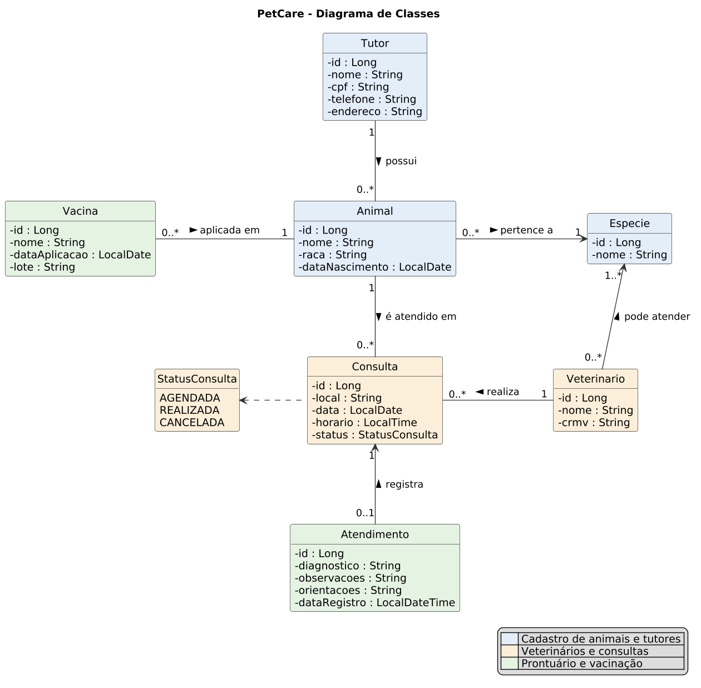

# PetCare API

API REST para gerenciamento de clínicas veterinárias, desenvolvida para a PetCare Digital Solutions LTDA com Java, Spring Boot, Spring Data JPA e banco de dados relacional H2.

## Aluno

| Nome | RA |
|------|----|
| Vitor Augusto de Almeida | 240238 |

## Tecnologias

- Java 17
- Spring Boot 3.5 (Web, Data JPA, Validation)
- Banco de dados H2, gravado em arquivo
- Lombok
- Maven (o projeto já traz o Maven Wrapper)
- Thunder Client, para os testes dos endpoints

## Como executar

É preciso ter o **JDK 17 ou superior** instalado. Maven não é necessário.

Na pasta do projeto, execute:

```bash
./mvnw spring-boot:run
```

No Windows, use `mvnw.cmd spring-boot:run`.

A API sobe em `http://localhost:8081`. Se essa porta estiver ocupada, escolha outra:

```bash
./mvnw spring-boot:run -Dspring-boot.run.arguments=--server.port=8082
```

### Banco de dados

Os dados ficam em `./data/petcare.mv.db` e continuam salvos depois de reiniciar a API. Para começar com o banco vazio, pare a API e apague a pasta `data`.

Para ver as tabelas, acesse o console do H2 em `http://localhost:8081/h2-console`:

- **JDBC URL:** `jdbc:h2:file:./data/petcare`
- **Usuário:** `sa`
- **Senha:** `password`

## Arquitetura

O código segue a arquitetura em camadas, dentro de `src/main/java/br/com/petcare/clinica`:

| Pacote | Responsabilidade |
|--------|------------------|
| `controllers` | Endpoints REST: recebem a requisição e delegam ao service |
| `services` | Interfaces e implementações com **as regras de negócio** |
| `repositories` | Acesso ao banco com `JpaRepository` e consultas personalizadas |
| `models` | Entidades JPA e seus relacionamentos |
| `dtos` | Objetos de entrada (`XxxRequestDTO`, com Bean Validation) e de saída (`DadosXxxDTO`) |
| `exceptions` | Exceções de negócio |
| `config` | `ApplicationControllerAdvice`: transforma exceções em respostas HTTP |

## Diagrama de classes



O código-fonte do diagrama, em PlantUML, está em [docs/diagrama-classes.puml](docs/diagrama-classes.puml).

Relacionamentos implementados:

| Relacionamento | Tipo |
|----------------|------|
| Tutor e Animal | `@OneToMany` / `@ManyToOne` |
| Animal e Especie | `@ManyToOne` |
| Veterinario e Especie | `@ManyToMany`, com a tabela `veterinario_especie` |
| Animal e Consulta | `@OneToMany` / `@ManyToOne` |
| Veterinario e Consulta | `@OneToMany` / `@ManyToOne` |
| Atendimento e Consulta | `@OneToOne` |
| Animal e Vacina | `@OneToMany` / `@ManyToOne` |

## Regras de negócio

Todas estão na camada de serviços.

**Consultas**

- Um veterinário não pode ter duas consultas na mesma data e horário. Consultas canceladas liberam o horário.
- O veterinário precisa estar habilitado para a espécie do animal.
- Não é possível agendar para data ou horário já passados.
- A consulta cancelada ou já realizada não pode ser cancelada de novo.
- Agendamentos simultâneos para o mesmo veterinário são processados um de cada vez, com um bloqueio no banco (`@Lock`), para que os dois não ocupem o mesmo horário.

**Atendimentos e vacinas**

- O atendimento é registrado a partir de uma consulta agendada, somente na data da consulta ou depois dela. Ao ser registrado, a consulta passa para `REALIZADA`.
- Cada consulta tem no máximo um atendimento, e uma consulta cancelada não pode ter atendimento.
- Diagnóstico e orientações são obrigatórios; observações são opcionais.
- A data de aplicação da vacina não pode estar no futuro nem ser anterior ao nascimento do animal.

**Cadastros**

- CPF, CRMV e nome da espécie são únicos. O CPF é guardado só com os dígitos, então `123.456.789-09` e `12345678909` são o mesmo tutor.
- O CPF é validado com `@CPF`, e o CRMV deve seguir o formato `CRMV-UF 12345`.
- A espécie de um animal não muda enquanto ele tiver consultas agendadas. Da mesma forma, o veterinário não perde a habilitação de uma espécie enquanto tiver consultas agendadas dela.
- Registros em uso não podem ser removidos: tutor com animais, animal com consultas ou vacinas, veterinário com consultas e espécie vinculada a animais ou veterinários.

## Consultas personalizadas

| Repositório | Método | Tipo | Finalidade |
|-------------|--------|------|------------|
| `TutorRepository` | `findByNomeContainingIgnoreCaseOrderByNome` | Query Method | Busca tutores por parte do nome |
| `AnimalRepository` | `buscarTodosComEspecieETutor` | `@Query` com `join fetch` | Lista animais com espécie e tutor em uma só consulta |
| `VeterinarioRepository` | `buscarHabilitadosParaEspecie` | `@Query` | Veterinários que atendem uma espécie |
| `VeterinarioRepository` | `buscarPorIdComBloqueio` | `@Query` com `@Lock` | Evita agendamentos simultâneos no mesmo horário |
| `ConsultaRepository` | `existsByVeterinarioIdAndDataAndHorarioAndStatusNot` | Query Method | Verifica se o horário do veterinário está ocupado |
| `ConsultaRepository` | `buscarComFiltros` | `@Query` com `join fetch` | Agenda filtrada por animal, veterinário, data e status |
| `AtendimentoRepository` | `buscarHistoricoDoAnimal` | `@Query` com `join fetch` | Atendimentos de um animal |
| `VacinaRepository` | `findByAnimalIdOrderByDataAplicacaoDesc` | Query Method | Vacinas de um animal |

## Endpoints

### Espécies

| Método | Rota | Descrição |
|--------|------|-----------|
| POST | `/api/especie` | Cadastra uma espécie |
| GET | `/api/especie` | Lista as espécies |
| GET | `/api/especie/{id}` | Consulta uma espécie |
| PUT | `/api/especie/{id}` | Edita uma espécie |
| DELETE | `/api/especie/{id}` | Remove uma espécie |

### Tutores

| Método | Rota | Descrição |
|--------|------|-----------|
| POST | `/api/tutor` | Cadastra um tutor |
| GET | `/api/tutor?nome=` | Lista os tutores; `nome` é opcional |
| GET | `/api/tutor/{id}` | Consulta um tutor |
| GET | `/api/tutor/{id}/animais` | Lista os animais do tutor |
| PUT | `/api/tutor/{id}` | Edita um tutor |
| DELETE | `/api/tutor/{id}` | Remove um tutor |

### Animais

| Método | Rota | Descrição |
|--------|------|-----------|
| POST | `/api/animal` | Cadastra um animal |
| GET | `/api/animal` | Lista os animais |
| GET | `/api/animal/{id}` | Consulta um animal |
| GET | `/api/animal/{id}/historico` | Histórico de atendimentos e vacinas |
| GET | `/api/animal/{id}/historico/impressao` | Histórico em página para impressão (HTML) |
| PUT | `/api/animal/{id}` | Edita um animal |
| DELETE | `/api/animal/{id}` | Remove um animal |

### Veterinários

| Método | Rota | Descrição |
|--------|------|-----------|
| POST | `/api/veterinario` | Cadastra um veterinário |
| GET | `/api/veterinario?especieId=` | Lista os veterinários; `especieId` é opcional |
| GET | `/api/veterinario/{id}` | Consulta um veterinário |
| PUT | `/api/veterinario/{id}` | Edita um veterinário |
| DELETE | `/api/veterinario/{id}` | Remove um veterinário |

### Consultas

| Método | Rota | Descrição |
|--------|------|-----------|
| POST | `/api/consulta` | Agenda uma consulta |
| GET | `/api/consulta?animalId=&veterinarioId=&data=&status=` | Consulta a agenda; todos os filtros são opcionais |
| GET | `/api/consulta/{id}` | Consulta um agendamento |
| PATCH | `/api/consulta/{id}/cancelar` | Cancela um agendamento |

### Atendimentos

| Método | Rota | Descrição |
|--------|------|-----------|
| POST | `/api/atendimento` | Registra um atendimento |
| GET | `/api/atendimento?animalId=` | Lista os atendimentos; `animalId` é opcional |
| GET | `/api/atendimento/{id}` | Consulta um atendimento |
| GET | `/api/atendimento/{id}/impressao` | Atendimento em página para impressão (HTML) |

### Vacinas

| Método | Rota | Descrição |
|--------|------|-----------|
| POST | `/api/vacina` | Registra uma vacina aplicada |
| GET | `/api/vacina?animalId=` | Lista as vacinas de um animal |
| GET | `/api/vacina/{id}` | Consulta uma vacina |

As páginas de impressão abrem no navegador e têm um botão **Imprimir**.

### Exemplos

Agendar uma consulta:

```json
{
  "animalId": 1,
  "veterinarioId": 1,
  "local": "Clínica Centro - Sala 1",
  "data": "2030-03-15",
  "horario": "10:00"
}
```

Formato das respostas de erro:

```json
{
  "errors": ["Veterinário já possui consulta agendada nesta data e horário."]
}
```

| Status | Quando ocorre |
|--------|---------------|
| 400 | Dados inválidos ou regra de negócio violada |
| 404 | Registro inexistente |
| 409 | Conflito: duplicidade, horário ocupado ou registro em uso |

## Testes

### Thunder Client

A coleção com 50 requisições, de sucesso e de erro, está em [thunder-client/PetCare.postman_collection.json](thunder-client/PetCare.postman_collection.json). Ela usa o formato Postman v2.1, que o Thunder Client importa no plano gratuito em qualquer conta.

Para executar:

1. Instale a extensão Thunder Client no VS Code. Ela pede uma conta gratuita.
2. Inicie a API com o banco vazio. As requisições usam ids fixos e dependem disso.
3. Em **Collections**, abra o menu e escolha **Import**, selecionando o arquivo da coleção.
4. Execute as requisições na ordem numérica. O nome de cada uma termina com o status esperado.

### Resultado dos testes

As 50 requisições foram executadas em ordem no Thunder Client 3.2.0, com o banco vazio, e todas retornaram o status esperado. Os prints estão em [docs/testes-thunder-client](docs/testes-thunder-client).

**1. Espécies**

| # | Cenário | Requisição | Status | Print |
|---|---------|------------|--------|-------|
| 01 | Criar espécie Cão | `POST /api/especie` | 201 | [ver](docs/testes-thunder-client/01-criar-especie-cao.png) |
| 02 | Criar espécie Gato | `POST /api/especie` | 201 | [ver](docs/testes-thunder-client/02-criar-especie-gato.png) |
| 03 | Erro - espécie duplicada | `POST /api/especie` | 409 | [ver](docs/testes-thunder-client/03-erro-especie-duplicada.png) |
| 04 | Listar espécies | `GET /api/especie` | 200 | [ver](docs/testes-thunder-client/04-listar-especies.png) |

**2. Tutores**

| # | Cenário | Requisição | Status | Print |
|---|---------|------------|--------|-------|
| 05 | Cadastrar tutor | `POST /api/tutor` | 201 | [ver](docs/testes-thunder-client/05-cadastrar-tutor.png) |
| 06 | Erro - CPF inválido | `POST /api/tutor` | 400 | [ver](docs/testes-thunder-client/06-erro-cpf-invalido.png) |
| 07 | Erro - CPF duplicado | `POST /api/tutor` | 409 | [ver](docs/testes-thunder-client/07-erro-cpf-duplicado.png) |
| 08 | Erro - campos obrigatórios | `POST /api/tutor` | 400 | [ver](docs/testes-thunder-client/08-erro-campos-obrigatorios.png) |
| 09 | Buscar tutor por nome | `GET /api/tutor?nome=maria` | 200 | [ver](docs/testes-thunder-client/09-buscar-tutor-por-nome.png) |
| 10 | Consultar tutor por id | `GET /api/tutor/1` | 200 | [ver](docs/testes-thunder-client/10-consultar-tutor-por-id.png) |
| 11 | Erro - tutor inexistente | `GET /api/tutor/999` | 404 | [ver](docs/testes-thunder-client/11-erro-tutor-inexistente.png) |
| 12 | Editar tutor | `PUT /api/tutor/1` | 200 | [ver](docs/testes-thunder-client/12-editar-tutor.png) |

**3. Animais**

| # | Cenário | Requisição | Status | Print |
|---|---------|------------|--------|-------|
| 13 | Cadastrar animal Rex | `POST /api/animal` | 201 | [ver](docs/testes-thunder-client/13-cadastrar-animal-rex.png) |
| 14 | Cadastrar animal Mia | `POST /api/animal` | 201 | [ver](docs/testes-thunder-client/14-cadastrar-animal-mia.png) |
| 15 | Erro - tutor inexistente | `POST /api/animal` | 404 | [ver](docs/testes-thunder-client/15-erro-tutor-inexistente.png) |
| 16 | Erro - nascimento no futuro | `POST /api/animal` | 400 | [ver](docs/testes-thunder-client/16-erro-nascimento-no-futuro.png) |
| 17 | Listar animais do tutor | `GET /api/tutor/1/animais` | 200 | [ver](docs/testes-thunder-client/17-listar-animais-do-tutor.png) |
| 18 | Erro - remover tutor com animais | `DELETE /api/tutor/1` | 409 | [ver](docs/testes-thunder-client/18-erro-remover-tutor-com-animais.png) |

**4. Veterinários**

| # | Cenário | Requisição | Status | Print |
|---|---------|------------|--------|-------|
| 19 | Cadastrar veterinária (Cão) | `POST /api/veterinario` | 201 | [ver](docs/testes-thunder-client/19-cadastrar-veterinaria-cao.png) |
| 20 | Cadastrar veterinário (Cão e Gato) | `POST /api/veterinario` | 201 | [ver](docs/testes-thunder-client/20-cadastrar-veterinario-cao-e-gato.png) |
| 21 | Erro - CRMV inválido | `POST /api/veterinario` | 400 | [ver](docs/testes-thunder-client/21-erro-crmv-invalido.png) |
| 22 | Erro - CRMV duplicado | `POST /api/veterinario` | 409 | [ver](docs/testes-thunder-client/22-erro-crmv-duplicado.png) |
| 23 | Erro - espécie inexistente | `POST /api/veterinario` | 404 | [ver](docs/testes-thunder-client/23-erro-especie-inexistente.png) |
| 24 | Listar habilitados para Gato | `GET /api/veterinario?especieId=2` | 200 | [ver](docs/testes-thunder-client/24-listar-habilitados-para-gato.png) |

**5. Consultas**

| # | Cenário | Requisição | Status | Print |
|---|---------|------------|--------|-------|
| 25 | Agendar consulta | `POST /api/consulta` | 201 | [ver](docs/testes-thunder-client/25-agendar-consulta.png) |
| 26 | Erro - veterinário no mesmo horário | `POST /api/consulta` | 409 | [ver](docs/testes-thunder-client/26-erro-veterinario-no-mesmo-horario.png) |
| 27 | Erro - veterinário não habilitado | `POST /api/consulta` | 400 | [ver](docs/testes-thunder-client/27-erro-veterinario-nao-habilitado.png) |
| 28 | Erro - data no passado | `POST /api/consulta` | 400 | [ver](docs/testes-thunder-client/28-erro-data-no-passado.png) |
| 29 | Erro - horário mal formatado | `POST /api/consulta` | 400 | [ver](docs/testes-thunder-client/29-erro-horario-mal-formatado.png) |
| 30 | Consultar agendamento por id | `GET /api/consulta/1` | 200 | [ver](docs/testes-thunder-client/30-consultar-agendamento-por-id.png) |
| 31 | Consultar agenda com filtros | `GET /api/consulta?veterinarioId=1&amp;status=AGENDADA` | 200 | [ver](docs/testes-thunder-client/31-consultar-agenda-com-filtros.png) |
| 32 | Erro - consulta inexistente | `GET /api/consulta/999` | 404 | [ver](docs/testes-thunder-client/32-erro-consulta-inexistente.png) |
| 33 | Cancelar consulta | `PATCH /api/consulta/1/cancelar` | 200 | [ver](docs/testes-thunder-client/33-cancelar-consulta.png) |
| 34 | Erro - cancelar novamente | `PATCH /api/consulta/1/cancelar` | 400 | [ver](docs/testes-thunder-client/34-erro-cancelar-novamente.png) |
| 35 | Reagendar no horário liberado | `POST /api/consulta` | 201 | [ver](docs/testes-thunder-client/35-reagendar-no-horario-liberado.png) |

**6. Atendimentos**

| # | Cenário | Requisição | Status | Print |
|---|---------|------------|--------|-------|
| 36 | Agendar consulta para hoje | `POST /api/consulta` | 201 | [ver](docs/testes-thunder-client/36-agendar-consulta-para-hoje.png) |
| 37 | Registrar atendimento | `POST /api/atendimento` | 201 | [ver](docs/testes-thunder-client/37-registrar-atendimento.png) |
| 38 | Erro - consulta já atendida | `POST /api/atendimento` | 409 | [ver](docs/testes-thunder-client/38-erro-consulta-ja-atendida.png) |
| 39 | Erro - consulta cancelada | `POST /api/atendimento` | 400 | [ver](docs/testes-thunder-client/39-erro-consulta-cancelada.png) |
| 40 | Erro - consulta futura | `POST /api/atendimento` | 400 | [ver](docs/testes-thunder-client/40-erro-consulta-futura.png) |
| 41 | Erro - sem diagnóstico | `POST /api/atendimento` | 400 | [ver](docs/testes-thunder-client/41-erro-sem-diagnostico.png) |
| 42 | Consultar atendimento | `GET /api/atendimento/1` | 200 | [ver](docs/testes-thunder-client/42-consultar-atendimento.png) |
| 43 | Imprimir atendimento | `GET /api/atendimento/1/impressao` | 200 | [ver](docs/testes-thunder-client/43-imprimir-atendimento.png) · [continuação](docs/testes-thunder-client/43-imprimir-atendimento-fim.png) |
| 44 | Erro - imprimir inexistente | `GET /api/atendimento/999/impressao` | 404 | [ver](docs/testes-thunder-client/44-erro-imprimir-inexistente.png) |

**7. Vacinas e histórico**

| # | Cenário | Requisição | Status | Print |
|---|---------|------------|--------|-------|
| 45 | Registrar vacina | `POST /api/vacina` | 201 | [ver](docs/testes-thunder-client/45-registrar-vacina.png) |
| 46 | Erro - anterior ao nascimento | `POST /api/vacina` | 400 | [ver](docs/testes-thunder-client/46-erro-anterior-ao-nascimento.png) |
| 47 | Erro - sem lote | `POST /api/vacina` | 400 | [ver](docs/testes-thunder-client/47-erro-sem-lote.png) |
| 48 | Consultar histórico do animal | `GET /api/animal/1/historico` | 200 | [ver](docs/testes-thunder-client/48-consultar-historico-do-animal.png) · [continuação](docs/testes-thunder-client/48-consultar-historico-do-animal-vacinas.png) |
| 49 | Imprimir histórico do animal | `GET /api/animal/1/historico/impressao` | 200 | [ver](docs/testes-thunder-client/49-imprimir-historico-do-animal.png) · [continuação](docs/testes-thunder-client/49-imprimir-historico-do-animal-fim.png) |
| 50 | Erro - histórico inexistente | `GET /api/animal/999/historico` | 404 | [ver](docs/testes-thunder-client/50-erro-historico-inexistente.png) |

### Testes automatizados

Os testes de integração usam um banco em memória, sem afetar a pasta `data`:

```bash
./mvnw test
```
